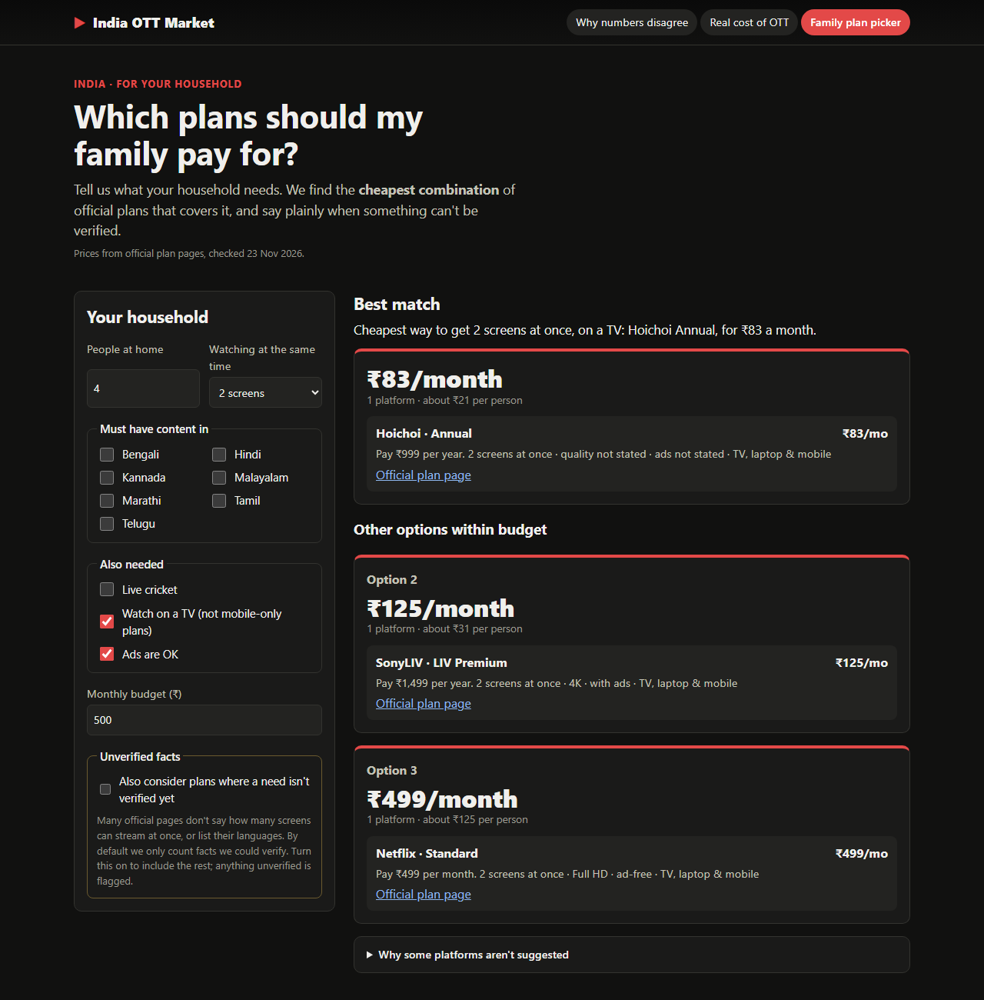

# India OTT Market Dashboard

An analysis of India's streaming (OTT) market: why subscriber numbers from different sources disagree, what streaming really costs in ₹, and which plan combination is best for a family.

> **Status: work in progress.** See [PROJECT_PLAN.md](PROJECT_PLAN.md) for the roadmap.

## Run the tests

```bash
python -m venv .venv
.venv\Scripts\activate          # Windows  (macOS/Linux: source .venv/bin/activate)
pip install -r requirements.txt
python -m pytest -q
```

## Run the analysis

```bash
python scripts/validate_data.py     # check every CSV against the data rules
python scripts/build_db.py          # data/*.csv -> build/ott.db (refuses invalid data)
python scripts/run_analysis.py      # print the answers to every question in sql/analysis.sql
```

The analysis notebook is [notebooks/analysis.ipynb](notebooks/analysis.ipynb). It is generated, so after a data change rebuild it with:

```bash
python scripts/make_notebook.py
jupyter nbconvert --to notebook --execute --inplace notebooks/analysis.ipynb
```

## View the dashboard

The dashboard is a static site in [dashboard/](dashboard/) (HTML + vanilla JavaScript + Chart.js). It reads JSON exported from the data:

```bash
python scripts/export_json.py               # data/*.csv -> dashboard/data/*.json
python -m http.server 8000 -d dashboard     # then open http://localhost:8000
```

Browsers block loading data from a file opened directly, so use the local server above.




The picker can be opened pre-filled, e.g. `picker.html?lang=Tamil,Telugu&screens=2&cricket=1&ads=0&budget=400&unverified=1`.

The picker's logic (`dashboard/js/picker.js`) is unit tested with Node's built-in test runner (`node --test tests/js/`); `python -m pytest` runs those tests too when Node.js is installed.
