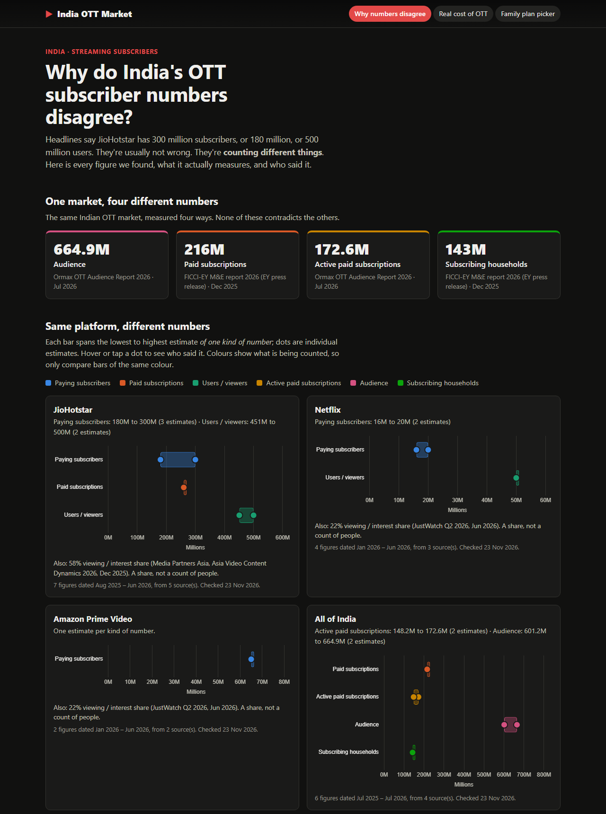
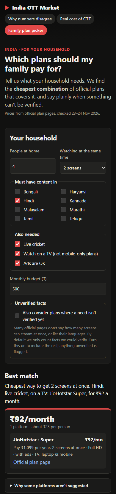
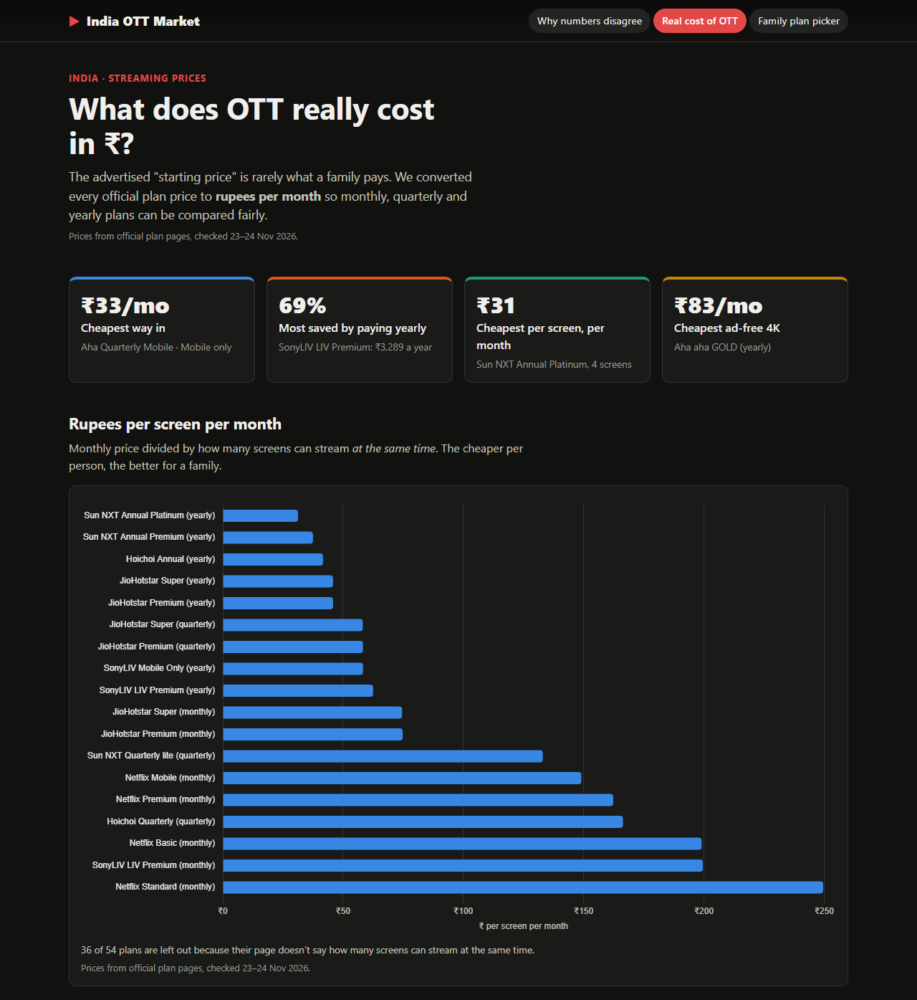
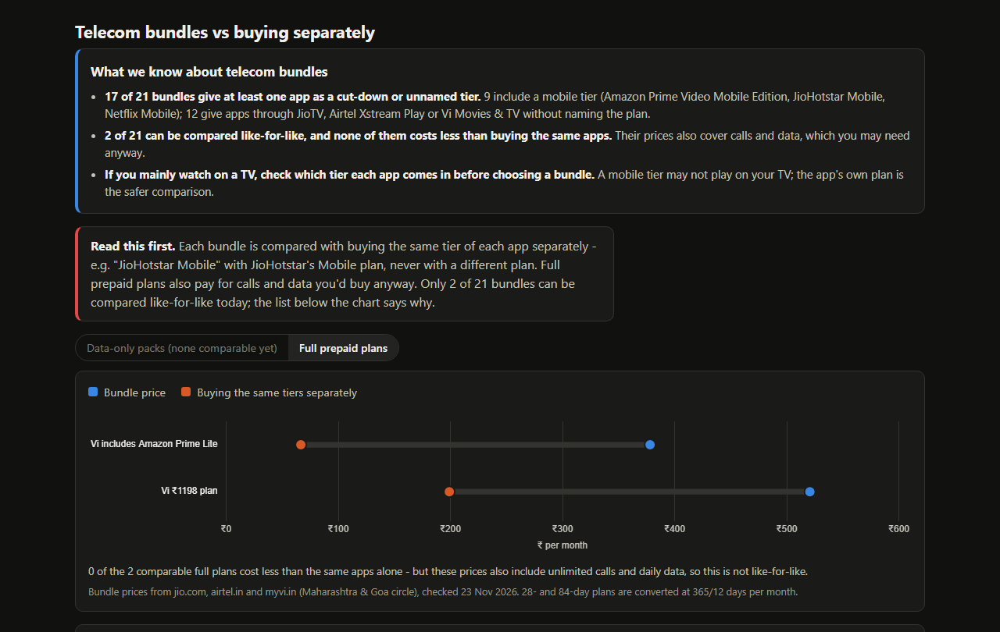
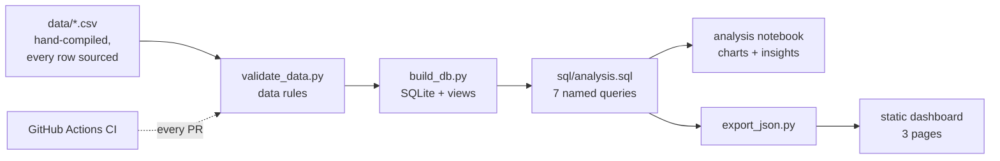

# India OTT Market Dashboard

[](https://github.com/SangitaZare/india-ott-dashboard/actions/workflows/ci.yml)

**Why do India's streaming subscriber numbers disagree, what does OTT really cost in ₹, and which plans should a family pay for?**
A data analytics project built on a hand-compiled, fully sourced dataset of Indian OTT platforms, plans, telecom bundles and subscriber figures.

**▶ Live dashboard: [sangitazare.github.io/india-ott-dashboard](https://sangitazare.github.io/india-ott-dashboard/)**

## The headline

> **One market, four "right" answers.** In 2025–26, **664.9M** Indians watched online video, **216M** paid video subscriptions were held by **143M** households, but only **172.6M** subscriptions were actually used in a month.
> And for India's biggest platform, JioHotstar, published "paying subscriber" figures range from **180M to 300M** (a 67% spread), depending on who is counting and when.

The numbers are rarely wrong. They count **different things** (people vs subscriptions vs households vs viewing share), on different dates, from sources with different incentives. This project records *what each number measures* and puts them side by side.

[](https://sangitazare.github.io/india-ott-dashboard/)

## Key findings

1. **Each source counts something different.** Audience (anyone watching, free or paid) ≠ paid subscriptions ≠ households ≠ subscriptions actually used. Always ask *what* a number counts before comparing.
2. **The same platform, very different numbers.** JioHotstar's paying-subscriber estimates run from 180M (Media Partners Asia) to 300M (company, Aug 2025). A year later the company itself said "over 260 million paid *subscriptions*".
3. **Paying yearly saves 38–69%** on every plan sold both monthly and yearly: from 38% on JioHotstar to 69% on SonyLIV Premium (₹4,788 over 12 monthly payments vs ₹1,499 for a year).
4. **Per screen, multi-screen yearly plans are 2–8× cheaper than Netflix:** ₹31–62 per screen per month (Sun NXT, Hoichoi, SonyLIV) vs ₹149–250 for Netflix. The cheapest ad-free 4K is Aha GOLD at ₹83/month vs Netflix Premium at ₹649.
5. **Most telecom bundles can't be compared like-for-like.** Only 2 of 21 include app tiers with an official price. The rest give tiers not sold on the web (JioHotstar Mobile, Prime Video Mobile Edition) or apps through an aggregator. Comparing them with each app's cheapest web plan would have shown savings of up to ₹207/month, but those were upper bounds, not real savings.

Prices were checked on official plan pages on **23–24 Nov 2026**. Full reasoning is in the [analysis notebook](notebooks/analysis.ipynb).

## The dashboard

A static site (HTML + vanilla JavaScript + Chart.js) with three pages, **live at [sangitazare.github.io/india-ott-dashboard](https://sangitazare.github.io/india-ott-dashboard/)** (re-published automatically on every merge to `main`):

| Page | Answers |
|---|---|
| **Why numbers disagree** | Every subscriber figure as a range per platform, coloured by what it counts; a glossary; a filterable source table with credibility and dates |
| **Real cost of OTT** | ₹ per screen per month; yearly vs monthly; ads vs ad-free; telecom bundles vs buying separately; every plan we checked |
| **Family plan picker** | The cheapest combination of plans for your screens, languages, live cricket, ads and budget, with why other platforms were ruled out |

### Family plan picker

A Hindi-speaking family that wants **live cricket on 2 screens and a TV** gets **JioHotstar Super at ₹92/month**, with every fact verified on official pages.
The picker never treats an unknown fact as "yes". A switch includes unverified facts, which are then flagged on the result.

<p>
  <a href="https://sangitazare.github.io/india-ott-dashboard/picker.html?lang=Hindi&cricket=1"></a>
  
</p>

### The real cost of OTT

Every plan converted to ₹ per month; per-screen cost; yearly vs monthly; ads vs ad-free. Telecom bundles are compared **like-for-like**, against the same tier bought separately.

<p>
  <a href="https://sangitazare.github.io/india-ott-dashboard/cost.html"></a>
  
</p>

## How it works



- **One source of truth for every calculation.** The notebook, the dashboard and the unit tests all run the same named SQL queries, so a number can't differ between them.
- **Prices are compared fairly.** Every price is converted to ₹ per month (quarterly ÷ 3, yearly ÷ 12; telecom 28- or 84-day plans at 365/12 days per month).
- **Unknown stays unknown.** A blank cell becomes NULL, never 0. A plan whose ads aren't stated is left out of "ad-free", not assumed ad-free.
- **Tested and enforced.** 200+ tests (Python + JavaScript) cover the data rules, every calculation and the picker's edge cases, and run in CI on Python 3.11 and 3.13 for every pull request.

## The data

| File | Rows | What |
|---|---|---|
| [`platforms.csv`](data/platforms.csv) | 9 | Netflix, Prime Video, JioHotstar, SonyLIV, ZEE5, Aha, Hoichoi, Sun NXT, Planet Marathi |
| [`prices.csv`](data/prices.csv) | 48 | Current plans for 7 platforms, from official plan pages only |
| [`bundles.csv`](data/bundles.csv) | 21 | Jio, Airtel and Vi plans that include OTT apps, from the providers' own pages |
| [`subscribers.csv`](data/subscribers.csv) | 19 | Subscriber / audience figures from 10 sources, each labelled with **what it measures** (7 metric types) and **source credibility** |

Columns and rules: [data dictionary](data/DATA_DICTIONARY.md). Original readings: [`data/raw/`](data/raw/).

**Data rules** (enforced by `validate_data.py` and CI):
- Every row has a source name, source URL, the date the figure refers to and the date it was checked.
- **Prices come only from official plan pages.** The validator rejects a price whose source isn't on the platform's own website.
- Nothing is guessed. An unverifiable value is left blank and listed in [`TODO_verify.md`](data/TODO_verify.md).
- Different measures (`paying_subscribers`, `subscriptions`, `subscribing_households`, `active_paid_subscriptions`, `viewers`, `audience`, `engagement_share_pct`) are never mixed.

**Sources**
- **Prices:** help.netflix.com, amazon.in, sonyliv.com, zee5.com, aha.video, hoichoi.tv, sunnxt.com; bundles from jio.com, airtel.in, myvi.in.
- **Subscribers:**
  - Ormax OTT Audience Reports 2025 and 2026; FICCI-EY M&E report 2026; Media Partners Asia (industry research)
  - Reliance AGM 2025 and 2026 statements; JioStar at APOS 2026 (company)
  - HSBC (broker estimate, second-hand)
  - The Core podcast; JustWatch via Inc42 (news)

## Limitations

- **A snapshot of prices.** Plans were checked on 23–24 Nov 2026 and change often. Telecom prices are for one circle (Maharashtra & Goa).
- **Gaps:** no verified prices yet for **Planet Marathi** or **JioHotstar's Mobile plan** (not on the web plans page), and Tata Play Binge plans sit behind a login. Bundles are compared only with the same tier bought separately, so only 2 of 21 are comparable today; the JioHotstar Mobile price (app only) would unlock 5 more.
- **Many plan details aren't stated** on official pages: screens at once (36 of 48 plans), supported devices, and the content languages of SonyLIV and ZEE5. Live cricket is verified only for JioHotstar and SonyLIV. These are left blank, which limits the per-screen comparison and the picker.
- **Some subscriber figures are second-hand:** HSBC via an entertainment site with no report date; Netflix's 16M via a podcast transcript. Each row says so in `notes`.
- **Not every value has been checked by hand yet.** Rows collected through AI-assisted browsing say so in `notes`. See [`TODO_verify.md`](data/TODO_verify.md) for everything still open.

## Run it yourself

```bash
python -m venv .venv
.venv\Scripts\activate                       # Windows  (macOS/Linux: source .venv/bin/activate)
pip install -r requirements.txt

python scripts/validate_data.py              # check every CSV against the data rules
python -m pytest -q                          # all tests (needs Node.js for the picker tests)

python scripts/build_db.py                   # data/*.csv -> build/ott.db (refuses invalid data)
python scripts/run_analysis.py               # print the answer to every question

python scripts/export_json.py                # data -> dashboard/data/*.json
python -m http.server 8000 -d dashboard      # open http://localhost:8000
```

The notebook is generated. After a data change, rebuild it with `python scripts/make_notebook.py`, then `jupyter nbconvert --to notebook --execute --inplace notebooks/analysis.ipynb`.

The picker can be opened pre-filled, e.g. `picker.html?lang=Tamil,Telugu&screens=2&cricket=1&ads=0&budget=400&unverified=1`.

## Project structure

```
data/          CSV datasets, data dictionary, raw source notes, TODO_verify.md
scripts/       schemas, validator, database build, analysis runner, JSON export, notebook generator
sql/           views.sql (shared logic) + analysis.sql (named queries)
notebooks/     analysis.ipynb (generated) + insights.md
dashboard/     static site: 3 pages, css/, js/, data/ (exported JSON)
tests/         pytest suites + tests/js/ (Node picker tests)
docs/          screenshots, resume bullets, LinkedIn draft
.github/       CI workflow and PR template
```

## Tech stack

Python (pandas, sqlite3) · SQL (SQLite, window functions, CTEs) · Jupyter + matplotlib · HTML/CSS/vanilla JavaScript + Chart.js · pytest + Node test runner · GitHub Actions.
Planned v2: the family picker rebuilt in Angular + ASP.NET Core (see [PROJECT_PLAN.md](PROJECT_PLAN.md)).
